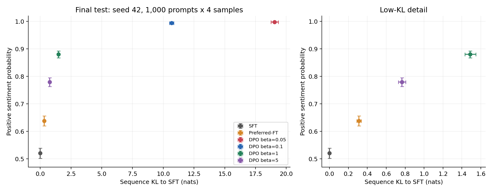
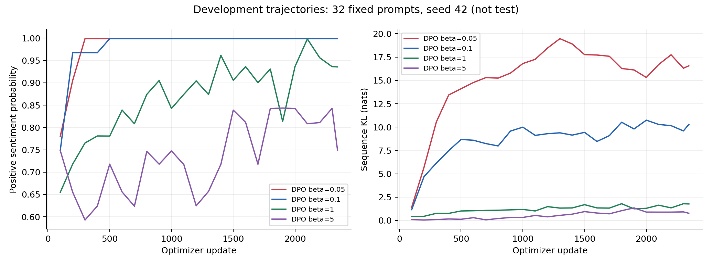

# DPO 最终复现报告

> 完成时间：2026-10-11 01:44:04（Asia/Singapore，UTC+8）。  
> 范围：GPT-2 Large + IMDb 正向情感控制；SFT、Preferred-FT、DPO；不含 PPO 对照。  
> 状态：benchmark → pilot → full 全队列完成，十组最终测试与三 seed 汇总已核验。  
> 数据依据：[完整结果快照](results/final-2026-10-11/README.md)、[机器可读核验结果](results/final-2026-10-11/derived/analysis.json)、[实验规划与实现差异](report.md)。

## 1 结论

本次完成了计划中的第一版单卡复现。DPO 在当前 IMDb 情感控制设置下明显提高固定情感分类器的正面概率，并呈现清晰的 reward–KL 权衡。预设主配置 β=0.1 的三 seed 测试奖励为 **0.994014 ± 0.000401**，Preferred-FT 为 **0.639034 ± 0.003957**，SFT 为 **0.520583**。这里的 ± 是三个更新 seed 的样本标准差，不是 95% 置信区间。

主 DPO 相对 Preferred-FT 的平均奖励增加约 0.3550，同时平均序列 KL 从 0.3086 增加至 10.5045。奖励提高伴随更大的分布偏移，不能由这几个最终点推断 DPO 在相同 KL 预算下全面优于对照。没有运行 PPO，也不能宣称验证了 DPO 优于 PPO 或严格重现原论文全部数值。

高奖励不等于高文本质量。定向抽查发现语义跳跃、与负面前缀冲突、个别重复文本获得高分等问题；本报告将其作为实际限制呈现。

## 2 设置、数据与版本

- 硬件：1 × NVIDIA A100-SXM4-40GB；系统内存约 188 GiB；双路 Xeon E5-2695 v3。模型参数量 774,030,080，全参数训练。
- 环境：Python 3.12.3、PyTorch 2.6.0+cu124、Transformers 4.57.1、Datasets 4.3.0。训练用 NumPy 2.1.3；完整依赖见[锁文件](results/final-2026-10-11/requirements.lock.txt)。
- 模型与数据固定版本：GPT-2 Large `32b71b12589c2f8d625668d2335a01cac3249519`；情感分类器 `74cea614e245b0832c770ec9aa51bd58df965b9c`；IMDb `e6281661ce1c48d982bc483cf8a173c1bbeb5d31`。官方 DPO 对照源码 commit 为 `f8b8c0f49dc92a430bae41585f9d467d3618fe2f`。见[资源锁定清单](results/final-2026-10-11/configs/assets.lock.json)。
- SFT 实际使用 23,781 条影评，1 epoch、372 次更新；其中 9,912 条（约 41.68%）截断到最多 256 tokens。由官方 train 留出 1,000 条开发影评，并按规范化文本哈希去重与隔离官方 test。
- 训练前缀 25,000 个，来自 20,948 条不同影评；前缀长 2–8 tokens。同一影评可提供不同长度的前缀。每个前缀生成 4 条候选，共 100,000 条；最多六对偏好，去掉 3 对重复与 19 对同分后实际 **149,978 对**。
- 开发生成评测为 500 个前缀各 1 条；另有 2,999 对开发偏好，其中固定前 256 对用于训练验证。最终测试为官方 test 的固定 1,000 个不同影评前缀，每个采样 4 条，每组 4,000 条。
- 所有阶段 FP32、禁用 TF32 和 dropout。RMSprop：alpha=0.99、eps=1e-8、momentum=0、weight_decay=0；梯度范数裁剪阈值 10。SFT lr=1e-5，偏好更新 lr=1e-6，有效 batch=64；SFT micro=4，偏好 micro=8。偏好更新 warmup=150，之后保持常数学习率；每组偏好训练 2,344 次更新、1 epoch。
- 采样：temperature=1、top_p=1、top_k=0、repetition_penalty=1、最多 128 个新 tokens、batch=32。分类器输入为前缀与续写全文；无静默截断。DPO 采用 completion log-prob 总和；Preferred-FT 训练 chosen 的负 log-prob 总和。

实际规模与去重记录见[数据审计](results/final-2026-10-11/data/full/audit.json)和[偏好构造审计](results/final-2026-10-11/data/full/pairs_train_audit.json)。

## 3 运行完整性与核验边界

1. 队列状态为 complete，所有记录阶段 returncode=0；训练进程已经退出。正式训练日志没有非有限数值，更新编号连续，无 OOM/Traceback。九组偏好更新均达到 2,344 步，SFT 达到 372 步；各 run 的 resume_used=false。
2. 服务器十组 final checkpoint 配置均存在且更新数正确。本次依据配置和既有 model_sha256 记录核验产物，未重新加载所有模型或重新计算大权重文件哈希。之前的六项正确性测试及真实恢复验证保留为历史工程证据，本次未重复训练或重跑这些 GPU 测试。
3. 十组 test.metrics.json、十组 dev.metrics.json、最终 summary.json、seed_summary.json 和图表齐全；不存在 test.partial.jsonl 残留。最终协议在 10 月 10 日 23:34:01 冻结后开始 test，主 β=0.1、各 run 均使用最后 checkpoint，没有按 test 挑选 checkpoint。
4. 对服务器测试生成文件重新计算 SHA-256，与指标指纹全部相符；每组恰有 4,000 个不同生成 ID、1,000 个前缀且每前缀四条。逐样本数值均有限，十组测试前缀集合一致。
5. 本地 560 个同步源文件的 SHA-256 全部通过；从每前缀平均值独立重算测试均值、2,000 次前缀聚类 bootstrap 的 95% CI，以及两个三 seed 汇总，均与原产物一致。见[离线核验脚本](scripts/analyze_final_results.py)。
6. 服务器只读复核：train/dev/test 的影评 ID 集合两两交集为零，token 前缀集合两两交集为零；SFT 与三份前缀 JSONL 的哈希与数据审计一致。正式 reference 缓存探针的误差记录为 0，门槛 0.002；这是有限探针，不能理解成所有输入逐位一致。

## 4 正式结果：dev 与 test 分开报告

以下全部为 full profile；pilot 与 benchmark 不混入此表。reward 是固定情感分类器的平均正面概率，**不是分类准确率、人工质量分或复现成功率**。重复率为逐条 completion 的词级三元组重复率再取均值；长度单位为生成 token。

| 方法 / seed | dev reward | test reward（95% CI） | test KL（nats/sequence） | 平均长度 | 三元词组重复率 |
| --- | ---: | --- | ---: | ---: | ---: |
| SFT | 0.5078 | 0.5206 [0.5021, 0.5391] | -0.0000 | 119.04 | 0.236% |
| Preferred-FT / 42 | 0.6292 | 0.6386 [0.6201, 0.6562] | 0.3117 | 119.04 | 0.257% |
| Preferred-FT / 43 | 0.6115 | 0.6432 [0.6246, 0.6615] | 0.3068 | 118.32 | 0.260% |
| Preferred-FT / 44 | 0.5975 | 0.6353 [0.6170, 0.6541] | 0.3072 | 118.69 | 0.224% |
| DPO β=0.05 / 42 | 0.9989 | 0.9979 [0.9965, 0.9989] | 19.0422 | 111.71 | 0.218% |
| DPO β=0.1 / 42 | 0.9986 | 0.9939 [0.9909, 0.9964] | 10.6865 | 115.45 | 0.232% |
| DPO β=0.1 / 43 | 0.9929 | 0.9945 [0.9914, 0.9969] | 10.4269 | 109.96 | 0.244% |
| DPO β=0.1 / 44 | 0.9928 | 0.9937 [0.9904, 0.9965] | 10.4003 | 109.00 | 0.244% |
| DPO β=1 / 42 | 0.8666 | 0.8803 [0.8672, 0.8923] | 1.4878 | 118.44 | 0.263% |
| DPO β=5 / 42 | 0.7336 | 0.7795 [0.7634, 0.7956] | 0.7654 | 118.82 | 0.262% |

SFT 的原始 test KL 为 -7.49×10⁻⁸，其 95% CI 为 [-4.04×10⁻⁷, 2.59×10⁻⁷]，属于接近零的数值误差。表中保留四位小数可能显示为负零；不代表真实负 KL。其他配置的 KL 置信区间保存在[测试指标汇总](results/final-2026-10-11/derived/report_tables.json)。

置信区间先在每个前缀内平均四条输出，再对 1,000 个前缀做 2,000 次 bootstrap（rng=2026）；不将 4,000 条当独立前缀样本。此区间描述固定模型、固定评测设计的抽样不确定性，不覆盖训练全流程、分类器偏差或全部 IMDb 分布。

## 5 β 扫描与 reward–KL 权衡

上图使用 seed=42 的最终测试点与 95% CI；横轴是有限长度生成过程的 **nats/sequence**，不是每 token KL。估计量为从策略采样的 completion 上 log π_policy − log π_SFT 的序列总和。

- β=5：reward=0.7795，KL=0.7654，分布偏移较小。
- β=1：reward=0.8803，KL=1.4878，显示较强的情感改善，同时显著低于 β=0.1 的 KL。
- β=0.1：reward=0.9939，KL=10.6865，奖励接近饱和。
- β=0.05：reward=0.9979，KL=19.0422。相对 β=0.1 只增加约 0.0040 奖励，KL 却增加约 78%；不能把最高 reward 直接当成最优综合配置。

四档 β 在这些最终点上均体现不同的奖励—偏移取舍，没有一个 DPO 点同时具有更高 reward 和更低 KL 而严格支配另一档。主配置仍按预设保持 β=0.1；β=1 的较低 KL 是描述性观察，不是读取测试后另选出的新主结果。

训练轨迹来自固定 **32 个开发前缀**，每 100 步及末步记录一次。β=0.1 在约第 500 步已达到接近饱和的分类器奖励，后续 KL 总体增加；这提示继续训练的主要变化未必是有意义的质量提升。小曲线不能替代 500 前缀 dev 或 1,000 前缀 test，也不据此追溯选择最佳 checkpoint。

## 6 三 seed 稳定性

| 方法 | seeds | test reward 均值 ± 样本标准差 | test KL 均值 ± 样本标准差 |
| --- | --- | ---: | ---: |
| DPO β=0.1 | 42 / 43 / 44 | 0.994014 ± 0.000401 | 10.504534 ± 0.158106 |
| Preferred-FT | 42 / 43 / 44 | 0.639034 ± 0.003957 | 0.308569 ± 0.002713 |

三个 seed 共享 SFT、训练偏好和 reference，只改变偏好更新的数据顺序等随机状态。该结果说明**固定起点和数据下**主 DPO 的分类器奖励较稳定；不能代表重新做 SFT、候选采样或换任务后的全流程稳定性。其他 β 只有 seed=42，未完成四档 β 全部三 seed。

DPO 的平均长度仍从 seed42 的 115.45 降至 seed43/44 的 109.96/109.00，EOS 比例从 38.25% 升至 51.05%/52.15%。奖励的低方差不意味着所有生成行为都相同。

## 7 偏好验证与训练数值

| DPO 配置 | 验证 loss | 偏好准确率 |
| --- | ---: | ---: |
| DPO β=0.05 / 42 | 0.3529 | 86.72% |
| DPO β=0.1 / 42 | 0.3622 | 87.89% |
| DPO β=0.1 / 43 | 0.3570 | 86.72% |
| DPO β=0.1 / 44 | 0.3617 | 87.11% |
| DPO β=1 / 42 | 0.4490 | 81.64% |
| DPO β=5 / 42 | 1.2030 | 75.00% |

偏好准确率表示固定 256 对开发数据上隐式奖励 margin>0 的比例，不是人工偏好胜率。主配置的准确率约 86.7%–87.9%。β=5 的验证 loss 较大；不同 β 缩放不同，不能只按 loss 跨 β 排名。

Preferred-FT 日志里的 accuracy=0 是未定义该统计时的默认占位值，**不能解释成偏好准确率为零**。SFT 与 Preferred-FT 的 loss 分别使用 token 平均与序列总和，数值尺度也不可直接比较。所有正式训练记录的 loss、梯度范数和学习率均有限。

## 8 生成质量：有效情感控制与实际失败样本

本次同步了每组十条系统间隔样本（索引 0、400、…、3600），并加入最低 reward 五条、最高重复率五条，去重后最多二十条；选择规则见[原始核验记录](results/final-2026-10-11/derived/remote_audit.json)。文本保存在[样本目录](results/final-2026-10-11/derived/samples/)。本次实际阅读重点为 SFT、Preferred-FT seed42 和 DPO β=0.1/1/5 seed42 中的指定样本与极端样本；这是具名定向检查，未完成原规划的 50 前缀盲评，也不报告人工质量胜率。

- **情感控制有效**：同一前缀 `Kahin Pya`，SFT sample 0 给出明显负面续写，reward=0.00049；DPO β=0.1 的同索引续写为 “more than a pleasure to watch” 和 “the perfect mix between a drama and a comedy”，reward=0.99894。它清楚展示了情感方向变化，但文本中的人物、片名与关系缺少事实核验。
- **高分重复仍存在**：DPO β=0.1 seed42 sample 2277 反复出现 “One of my favorites, and one I watch often.”，reward=0.99891、三元组重复率=20.43%。平均重复率很低也不能排除个别坏样本。
- **分类器会给无意义文本高分**：SFT sample 2596 从 `Zzz` 续写大量 `003` 与标点，reward=0.99396、重复率=56.04%；Preferred-FT 对应样本重复率达到 71.91%。这种评估盲点在基线中已存在，不能全部归因于 DPO。
- **更大 β 也有高分退化**：DPO β=1 sample 2660 出现大量星号重复，reward=0.99766、重复率=81.48%。
- **前缀与续写语义冲突**：DPO β=0.1 sample 3171 的前缀是 `this show just sucks. i don`，续写又反复赞扬节目；全文分类器评分仅 0.00097。偏好优化并不保证局部语义一致或抵消所有负面前缀。

逐样本复核发现：DPO β=0.1 的 seed42/43/44 中，重复率>10%的输出分别为 1/2/4 条（各 4,000 条），均无 >50% 的输出。SFT 有 5 条 >10%、1 条 >50%；β=1 有 7 条 >10%、1 条 >50%。这些是尾部计数，不能换算为综合文本质量合格率。

## 9 耗时与资源

队列从 2026-10-08 18:47:33 运行至 2026-10-11 01:44:04，共 **54.94 小时**；full 从 10 月 8 日 19:58:20 开始，共 **53.76 小时**。以上均为 UTC+8，来自编排日志。

| full 阶段 | 实测墙钟时间 |
| --- | ---: |
| SFT | 0.83 小时 |
| 候选生成（训练与开发） | 4.64 小时 |
| 候选评分与偏好构造 | 0.22 小时 |
| reference 缓存 | 1.51 小时 |
| Preferred-FT × 3 | 9.00 小时 |
| DPO × 6 | 34.18 小时 |
| 开发集与训练曲线评测 | 1.19 小时 |
| 独立测试 × 10 | 2.17 小时 |

单次 DPO 阶段约 5 小时 42 分，Preferred-FT 约 3 小时；全部测试约 2 小时 10 分。表格是阶段墙钟时间，含相应加载、保存或评测开销，不是纯 kernel 时间，也不等同于持续满载 GPU 小时。环境安装、下载、早期 smoke 和报告整理未计入队列耗时。

训练进程记录的峰值 PyTorch reserved：SFT 14.74 GiB、Preferred-FT 最高 14.44 GiB、DPO 最高 14.13 GiB。该字段只代表被记录进程的 PyTorch 分配器峰值，不是服务器总显存或所有阶段统一峰值。没有完整功耗积分，因此不推算能耗或费用。

## 10 复现差异与局限性

| 项目 | 实际执行与结论限制 |
| --- | --- |
| 论文范围 | 只完成 IMDb 情感控制第一版；无 PPO/PPO-GT、HH 对话、TL;DR、Best-of-128 或人类研究。 |
| 数据与长度 | SFT 为去重留出后的 23,781 条，最多 256 tokens；训练前缀复用部分影评，续写最多 128 tokens。属于明确记录的工程设置。 |
| 实现与精度 | 手写 PyTorch RMSprop 循环；FP32、TF32/dropout 关闭。不是原作者训练环境的逐位复刻。 |
| 目标尺度 | Preferred-FT 使用 chosen 序列 NLL 总和且保留 pair 中的重复暴露；与 token 平均 SFT 尺度不同。 |
| 评估器 | 偏好构造和最终奖励都依赖同一固定情感分类器；未增加独立质量裁判，存在奖励投机与测量偏差。 |
| 统计范围 | test 为固定 1,000 影评子集；CI 为前缀重采样，三 seed 只覆盖偏好更新。 |
| 质量验收 | 完成自动指标和定向样本检查；未完成 50 前缀盲评、流畅性量化或事实核验，不能声称文本质量全面通过。 |
| 算法比较 | 最终 DPO 与 Preferred-FT 的 KL 不匹配；未做匹配预算下的最优前沿比较。 |

本次支持“DPO 能在此设置下有效优化情感偏好，并通过 β 调节奖励与分布偏移”，不支持“奖励越高文本越好”“完整论文数值已重现”或“DPO 已胜过 PPO”。

## 11 交付与复核入口

- [同步快照与清单](results/final-2026-10-11/README.md)：配置、版本、源码快照、训练日志、指标、曲线和选定样本；大模型权重与原始数据仍在服务器。
- [最终 summary.json](results/final-2026-10-11/results/full/summary.json)、[summary.csv](results/final-2026-10-11/results/full/summary.csv)、[seed_summary.json](results/final-2026-10-11/results/full/seed_summary.json)。
- [测试冻结协议](results/final-2026-10-11/results/full/test_protocol.json)、[编排日志](results/final-2026-10-11/logs/orchestrator.log)、[最终状态](results/final-2026-10-11/logs/pipeline_status.json)。
- [离线分析脚本](scripts/analyze_final_results.py)：使用 Python、NumPy 和 Matplotlib 运行；只读已同步证据，重算统计并生成 derived 图表，不连接服务器、不启动训练。

本报告与轻量结果快照归档至 Paper-Reading；原论文 PDF 与服务器训练产物保持不变。

**一句话结论：第一版 DPO 情感控制复现已完成，主配置稳定提高分类器奖励，但提升伴随更大 KL，生成质量仍需独立评估。**
